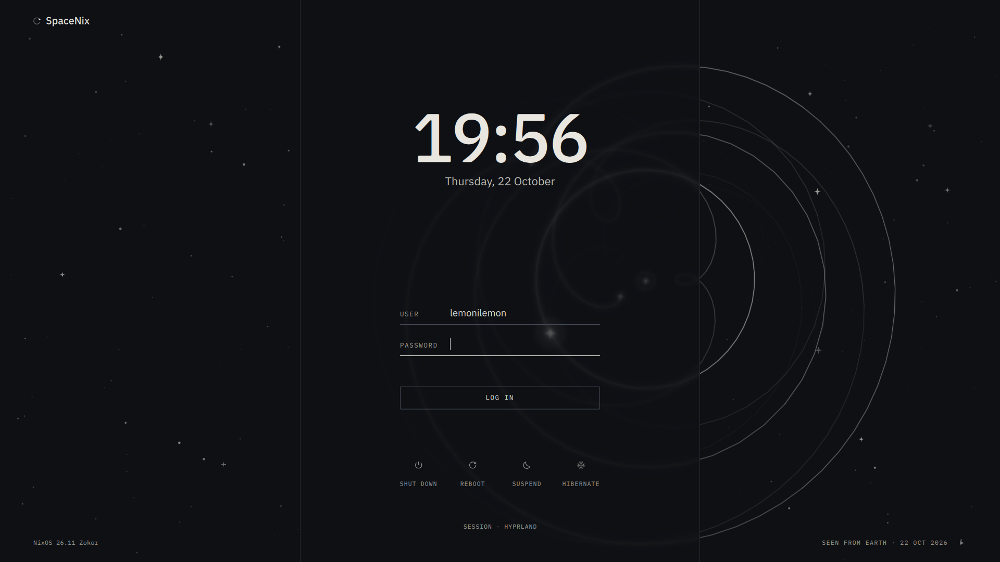
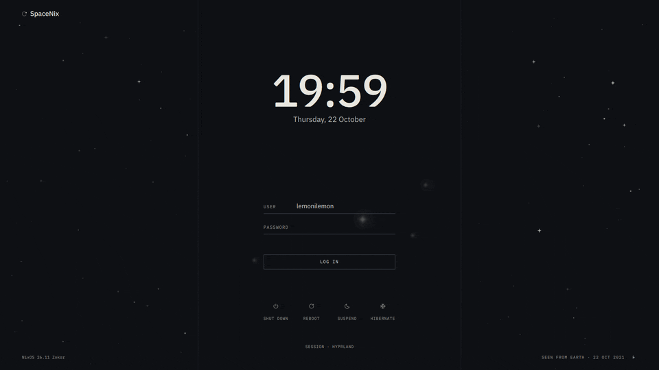
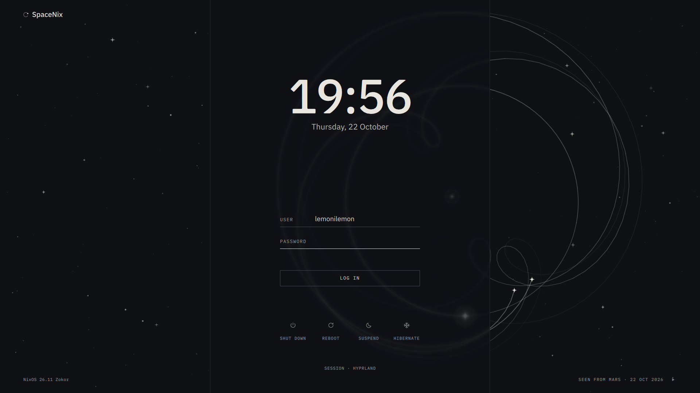
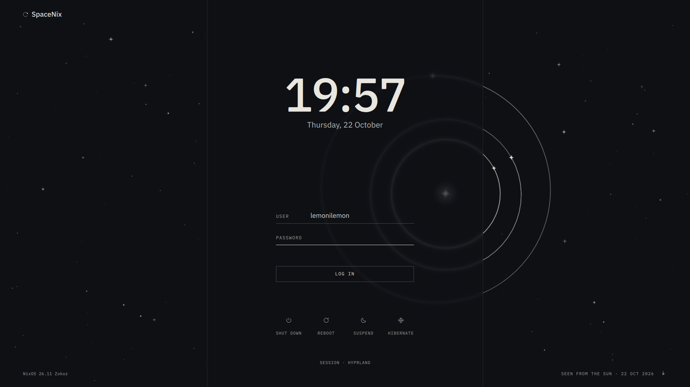
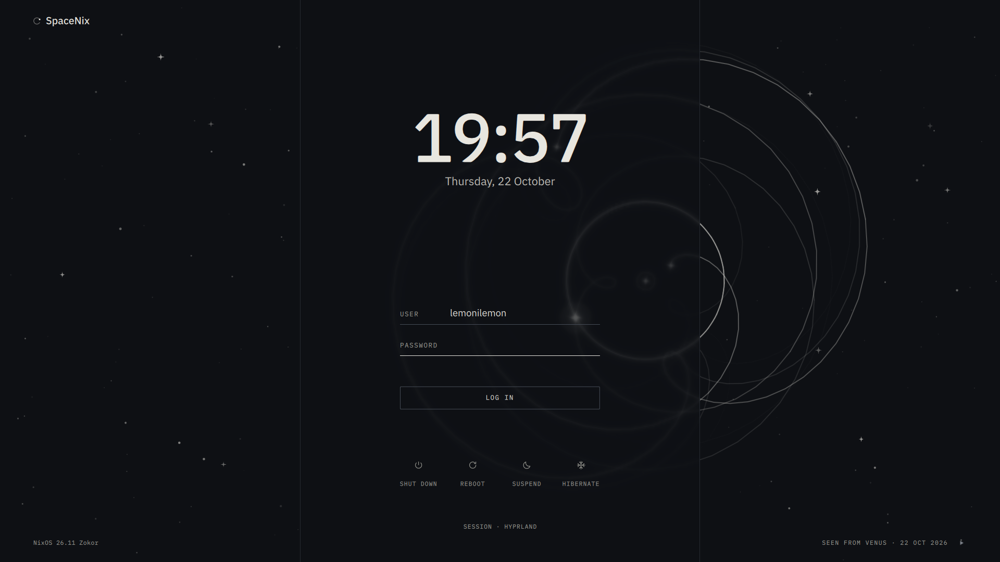

# Orrery



An SDDM theme in the style of [lemonilemon.csie.org](https://lemonilemon.csie.org/)'s
night page: the same star field, and the inner planets seen from Earth. The
planets sit where they really are on the day you log in, from J2000 mean orbital
elements (good to a few degrees). On load the last five years of their paths
draw in and stop on today.



The layout follows [sddm-astronaut-theme](https://github.com/Keyitdev/sddm-astronaut-theme):
a centred strip holds the clock and the form, and the orrery shows through it
blurred.

- Click a planet outside the strip, or the caption in the bottom-right corner,
  to see the others from it.
- The play button runs time forward from today; the caption's date follows.

| Seen from Mars | Seen from the Sun | Seen from Venus |
| --- | --- | --- |
|  |  |  |

Needs SDDM with Qt 6.6 or later. Text is set in IBM Plex Sans and IBM Plex
Mono; the package checks at build time that both families are in the font
package it ships with.

## NixOS

```nix
# flake.nix
inputs.sddm-orrery = {
  url = "github:lemonilemon/sddm-orrery";
  inputs.nixpkgs.follows = "nixpkgs";
};

# a NixOS module
{ inputs, pkgs, ... }:
let
  orrery = inputs.sddm-orrery.packages.${pkgs.stdenv.hostPlatform.system}.default.override {
    osLabel = "NixOS 26.11 Zokor";
  };
in
{
  services.displayManager.sddm.theme = "orrery";
  environment.systemPackages = [ orrery ];
  fonts.packages = [ orrery.fonts ];
}
```

The greeter runs as the `sddm` user and only sees system fonts, so
`fonts.packages` is not optional: without it the text falls back to another
face silently.

## Other distributions

Copy `theme/` to `/usr/share/sddm/themes/orrery`. The Nix package generates
`theme.conf`, so the repository doesn't have one; write it next to `Main.qml`:

```ini
[General]
Font=IBM Plex Sans
LabelFont=IBM Plex Mono
OsLabel=
ShowAllPowerButtons=false
```

Install IBM Plex Sans and IBM Plex Mono system-wide, then select the theme:

```ini
# /etc/sddm.conf.d/theme.conf
[Theme]
Current=orrery
```

`sddm-greeter-qt6 --test-mode --theme /usr/share/sddm/themes/orrery` opens it
in a window, so you can check it before logging out.

## Options

`package.nix` takes these as `override` arguments; they end up in `theme.conf`
under the key in the second column.

| Argument | Key | Default | Effect |
| --- | --- | --- | --- |
| `osLabel` | `OsLabel` | `""` | Text in the bottom-left corner; empty hides it |
| `hostLabel` | `HostLabel` | `null` | Text beside the mark in the top-left corner; `null` leaves the key out and shows the hostname, empty hides it |
| `showAllPowerButtons` | `ShowAllPowerButtons` | `false` | Show every power button even when SDDM reports it unavailable |

## Preview

```sh
nix run .#preview -- out.png 1920x1200 5
```

Renders the real `sddm-greeter-qt6 --test-mode` in a headless sway and saves a
screenshot after 5 seconds, once the intro has finished. Every argument is
optional. Test mode has no SDDM daemon, so the hostname is blank and the power
buttons are forced on.
